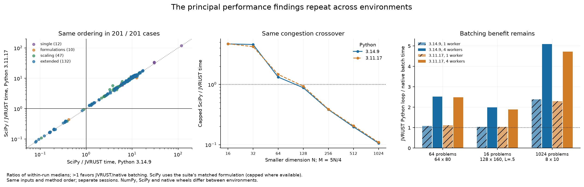
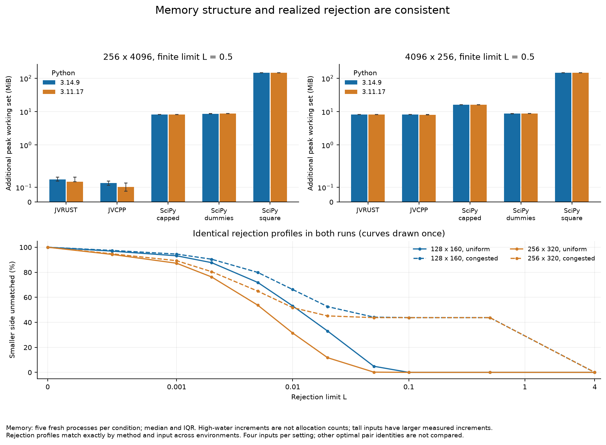
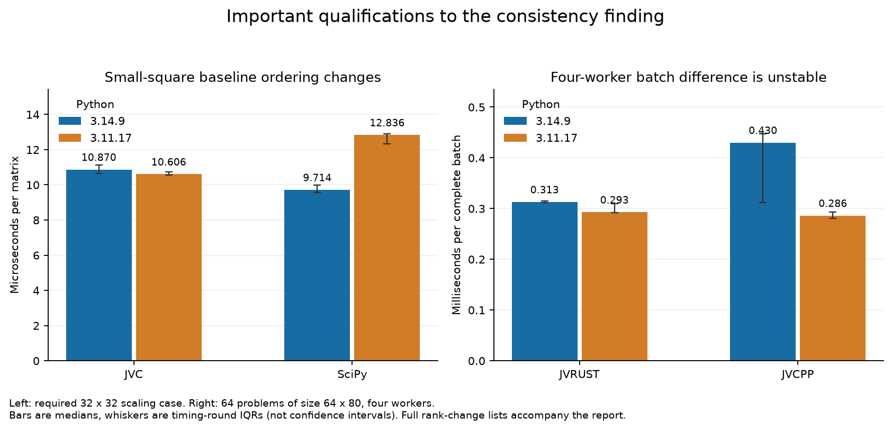
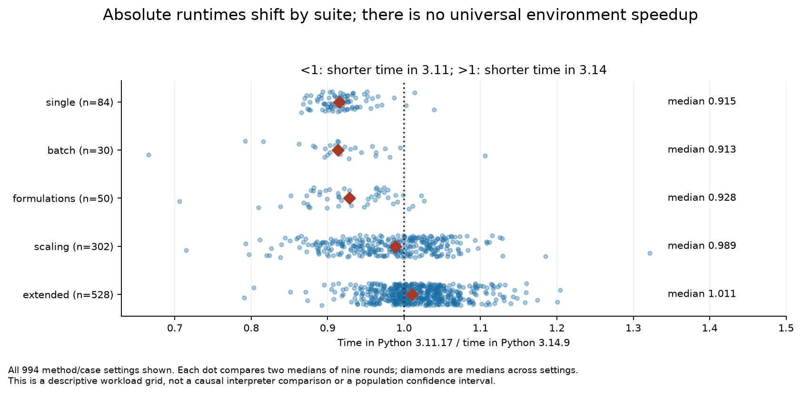

# Python 3.11.17 versus Python 3.14.9: consistency of the findings

The principal empirical findings are consistent across the two completed
collections. Correctness, rejection behavior, the native-versus-SciPy ordering,
the congested-family crossover, batching benefits, and memory trends repeat.
Exact runtimes and some implementation rankings do change, so small gaps and
the four-worker JVCPP result should not be presented as stable advantages.

This comparison is separate from the paper. All 1,717 existing source, result,
figure, and paper files covered by the preservation manifest remain unchanged.
No solver measurements were rerun.

## What was compared

The analysis covers all **994 method/case settings in 204 cases**, using
8,946 timing samples per environment, plus the 81 repeated-memory conditions
with five fresh processes per condition in each environment. It recalculates
timing and memory summaries from the raw samples before comparing them.

The case grids, solver package versions, seeds, repetition counts, CPU affinity,
and recorded method order match. All available input hashes agree: 40
formulation inputs, 188 scaling inputs, 528 extended timing inputs, 405 memory
trial inputs, and three batches. The original measurement scripts are
byte-identical between collections. The extension's interpreter and output
guards were adapted for the separate 3.11 collection without changing its
measurement protocol.

| Environment | Python 3.14.9 collection | Python 3.11.17 collection |
| --- | --- | --- |
| NumPy | 2.5.4 | 2.4.6 |
| SciPy | 1.18.1 | 1.17.1 |
| lapx / laprust / lapcpp | 0.11.1 / 1.0.0 / 1.0.0 | 0.11.1 / 1.0.0 / 1.0.0 |
| Host | Same Intel i9-13900KS / Windows host | Same host |
| Single / batch affinity | CPU 0 / CPUs 0-3 | Same |

These are two software environments and two measurement sessions. NumPy,
SciPy, native wheels, and host state can contribute to differences. This
comparison does not isolate a causal effect of the Python interpreter.

## Findings that repeat

| Finding | Python 3.14.9 | Python 3.11.17 | Assessment |
| --- | ---: | ---: | --- |
| Recorded per-input objectives and match counts | 3,520 records | Exactly the same 3,520 values | Consistent; maximum objective difference is zero |
| Edge-fixture checks | 129, including expected infeasibility | Identical records | Consistent |
| JVRUST beats capped SciPy in the formulation suite | 9 / 10 cases | Same 9 / 10 cases | Consistent; JVCPP wins the same nine cases too |
| JVRUST speedup over capped SciPy, 128 x 160, L=0.5 | 9.02x | 9.98x | Advantage remains |
| Capped SciPy speedup on the formulation congested-block case | 2.41x | 2.29x | Counterexample remains |
| First tested congested scaling size where capped SciPy beats JVRUST | N=128, M=160 | N=128, M=160 | Same sampled crossover, between N=64 and N=128 |
| Capped SciPy speedup on congested 1024 x 1280 | 9.42x | 9.15x | Large-size reversal remains |
| Small-problem JVRUST batch speedup over its loop, one worker | 2.39x | 2.30x | Serial batching benefit remains |
| Same small-problem batch, four workers | 5.10x | 4.73x | Parallel batching benefit remains |
| JVCPP time / JVRUST time on extreme tall inputs | 3.00-3.84x | 2.98-3.81x | Tall-orientation gap remains |

All speedups in this report are **ratios of the reported within-run median
times**. They may differ slightly from the existing figures that summarize
the nine within-round ratios. Both calculations describe these measured
inputs; neither is an application-wide confidence interval.



JVRUST's ordering against the relevant SciPy baseline is unchanged in **all
201 non-batch cases**. JVCPP also preserves its ordering against that baseline
in all 201 cases. Required cases use native SciPy; finite-limit cases use capped
SciPy where available. The original single-call suite's finite-limit SciPy
baseline remains its square-expanded formulation, so these baseline choices
must not be conflated.

| Suite | JVRUST wins, both runs | JVCPP wins, both runs |
| --- | ---: | ---: |
| Original single-call | 11 / 12 | 11 / 12 |
| Formulations | 9 / 10 | 9 / 10 |
| Original scaling | 43 / 47 | 42 / 47 |
| Extended | 112 / 132 | 112 / 132 |

The extension's twenty native losses are the same twenty in both runs:
sixteen congestion-sweep cases and four congested rejection-sweep cases.
The tested uniform large matrices, extreme rectangles, forbidden-entry
sweeps, tie sweeps, and signed cases preserve the native advantage against
the selected SciPy baseline. On the large squares and large rectangles,
JVCPP's median time stays within about 6% of JVRUST in both environments;
neither implementation wins at every point. The hybrid implementation also
does not establish a uniform benefit on these large required cases.

In the congestion sweep, a competing-row fraction of 0.25 favors the native
methods, while the tested fractions from 0.5 through 0.9 favor SciPy, in both
required and finite-limit regimes. In the congested rejection sweeps, capped
SciPy leads at the tested limits 0.5 and 4 in both environments. These are
grid observations; they do not locate every continuous crossover exactly.

## Memory and rejection behavior

The repeated-memory medians differ by at most **0.08984 MiB across all 81
conditions**. The compact-versus-square distinction and the wide-versus-tall
behavior remain clear. Examples for finite limit L=0.5 are:

| Shape and method | Python 3.14.9, MiB | Python 3.11.17, MiB |
| --- | ---: | ---: |
| 256 x 4096, JVRUST | 0.152 | 0.137 |
| 256 x 4096, capped SciPy | 8.098 | 8.090 |
| 256 x 4096, dummy-column SciPy | 8.641 | 8.664 |
| 256 x 4096, square-expanded SciPy | 144.734 | 144.742 |
| 4096 x 256, JVRUST | 8.172 | 8.141 |
| 4096 x 256, capped SciPy | 16.082 | 16.160 |
| 4096 x 256, square-expanded SciPy | 144.711 | 144.746 |

These are increments in process peak working set after the input is resident,
not exact allocation counts. Near-zero values should be compared in absolute
units: tiny changes can produce large or undefined percentage ratios. The
very small wide-input native increments must not be generalized to tall
inputs, whose increments are appreciably larger in both runs.

The realized rejection curves agree exactly by method and input. The congested
curves retain roughly 43.75% unmatched rows at intermediate limits and reach
full matching at the largest limit. Substantial rejection therefore still does
not guarantee a native runtime advantage. The check compares objective values
and cardinalities; it does not assert that every solver returns identical pair
identities when multiple optima exist.



## Changes that should qualify the discussion

Across all solvers, **62 of 2,104 pairwise median orderings reverse**, and the
single fastest median changes in **31 of 204 cases**. Much of this is close
competition between implementations. Requiring a reversed pair to have a
margin exceeding 2% in both runs leaves twelve reversals; requiring 5% or 10%
leaves one. This is a post-hoc descriptive sensitivity check, not a statistical
significance threshold, and it does not make the other changes unimportant.

Two examples deserve explicit attention:

- **Four-worker JVCPP batching:** on 64 problems of size 64 x 80, JVCPP takes
  0.430 ms against JVRUST's 0.313 ms in Python 3.14, approximately 37% longer.
  In Python 3.11 the medians are 0.286 and 0.293 ms, approximately tied, with
  JVCPP slightly faster. The 3.14 JVCPP IQR is wide (0.312-0.447 ms), so this
  comparison does not support a stable four-worker implementation ranking.
  The general batching benefit is preserved.
- **Small JVC/SciPy reversal:** in required 32 x 32 scaling, JVC/SciPy medians
  are 10.87/9.71 microseconds in Python 3.14 and 10.61/12.84 microseconds in
  Python 3.11. This is the sole reversal with more than a 5% margin on both
  sides. JVRUST remains faster than both, at 2.58 and 2.22 microseconds.



Absolute timing changes also differ by suite. The following statistics give
every method/case setting within a suite equal weight; they are not a workload
mix or an overall application speedup.

| Suite | Median of time(3.11) / time(3.14) across settings | Interpretation |
| --- | ---: | --- |
| Single-call | 0.915 | Median setting about 8.5% shorter in 3.11 |
| Batch | 0.913 | About 8.7% shorter |
| Formulations | 0.928 | About 7.2% shorter |
| Scaling | 0.989 | About 1.1% shorter |
| Extended | 1.011 | About 1.1% longer |



The evidence supports retaining the broad, workload-dependent findings when
the paper is eventually revised. Exact numerical examples and implementation
rankings should be tied to their measurement session. Repeated independent
sessions, especially for the four-worker batch case, would be needed before
making stronger claims about small differences or attributing changes to the
interpreter. The paper itself has not been edited.

## Evidence and reproduction

- [Machine-readable comparison](comparison.json) and [key metrics](key_metrics.csv)
- [All 994 timing comparisons](timing_comparison.csv)
- [All 402 native-versus-SciPy orderings](primary_orderings.csv)
- [Every pairwise reversal](pairwise_reversals.csv) and [all case winners](case_winners.csv)
- [All 81 memory comparisons](memory_comparison.csv)
- [Visual review](figure_review.json) and [artifact inventory](artifact_manifest.json)

The four charts also have SVG exports in `figures/`. The source collections
are `../../results/`, `../../extensions/python-3.14.9-20261024/`, and
`../../collections/python-3.11.17-20261024/`.

From this directory, run:

```powershell
C:\dev\exc\python\p311\python.exe compare.py
```

The script reads the saved measurements, independently recalculates their
summaries, checks input and schedule agreement, writes comparisons and charts
only here, and verifies preservation before and after analysis. Round numbers
are not treated as paired observations across the two sessions. The case grid
is designed rather than sampled from an application population, so no
population significance tests or confidence intervals are claimed.
