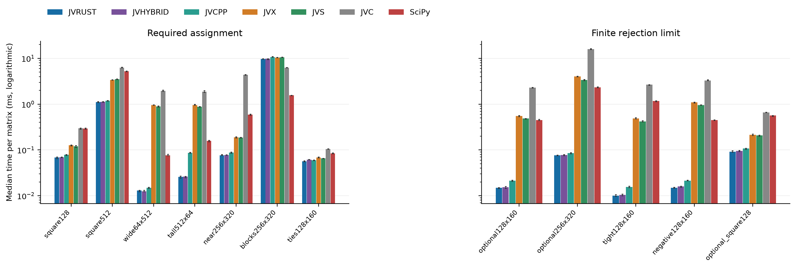
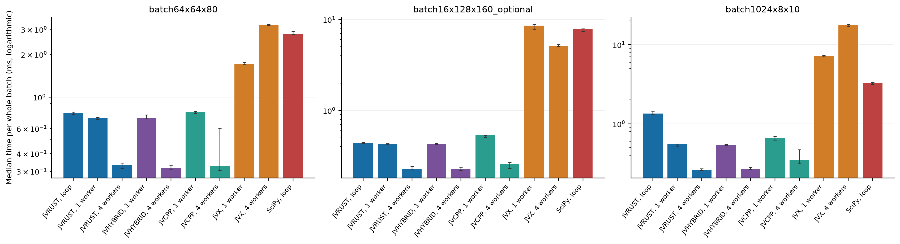
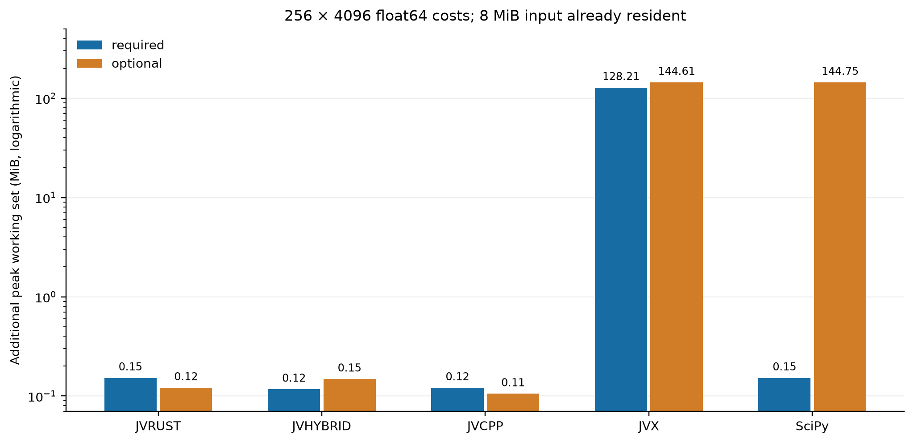
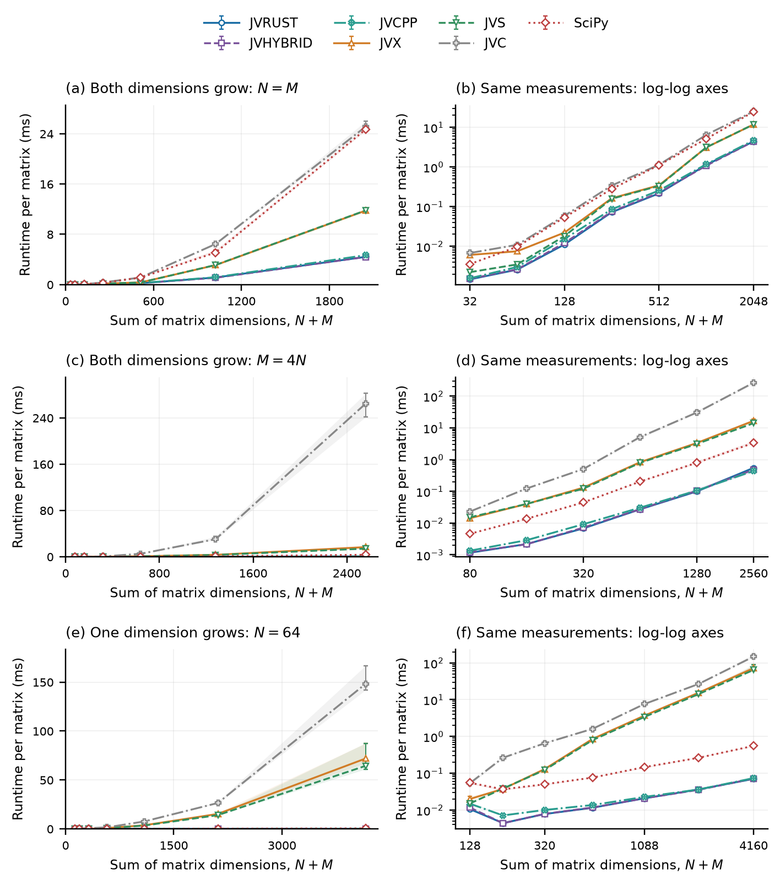
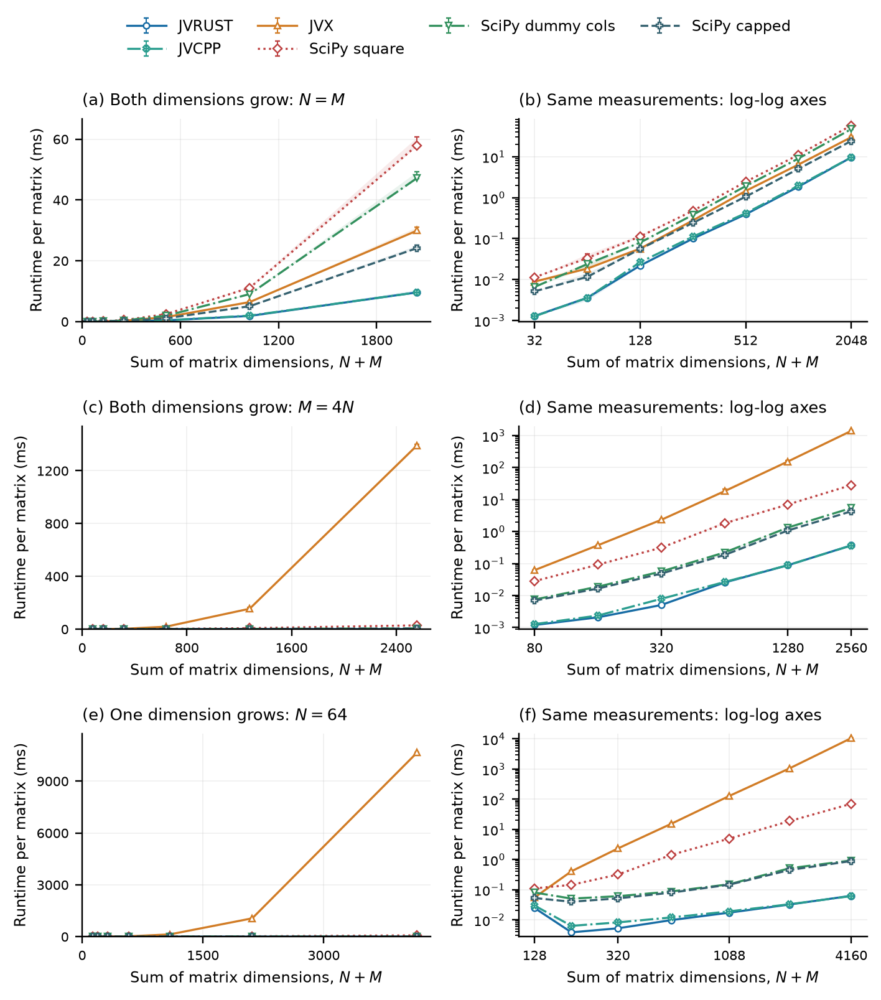
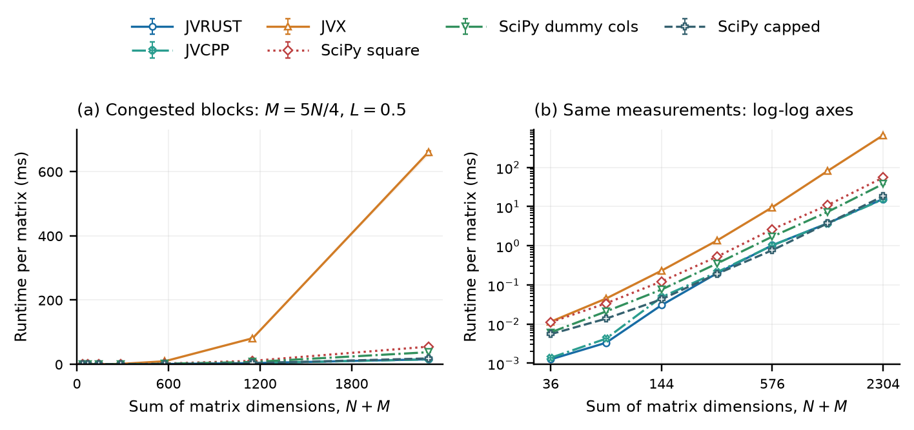
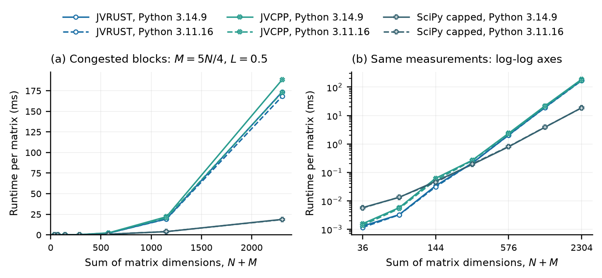

# Native Rectangular Linear Assignment with Implicit Rejection

**A Jonker–Volgenant Solver without Square Expansion**

**Ratha SIV**

22 October 2026

## Abstract

Tracking and matching applications often solve rectangular assignment with a uniform penalty for leaving elements unmatched. Widely used tracking code does this through a Jonker–Volgenant interface that embeds the N × M costs in an (N+M)-square matrix: for 256 rows and 4096 columns, 144.5 MiB of costs for an 8 MiB problem. We describe a Jonker–Volgenant implementation that keeps the real matrix and represents rejection inside its shortest-path search by a constant-size terminal, one distance and one predecessor row. Building on established rectangular and optional-assignment formulations, we derive the one-sided objective it optimizes and the primal-dual certificate it satisfies. Rust (JVRUST), hybrid Rust/C++ (JVHYBRID), and C++ (JVCPP) implementations with native batching agree with exhaustive enumeration and are compared with expanded solvers and with an exact capped-cost SciPy formulation on the original dimensions. On one Intel/Windows system, a 128 × 160 finite-limit problem takes 15.6 microseconds with JVRUST, 139.1 with SciPy on capped costs of the original dimensions, and 476.7 with square-expanded SciPy. JVRUST is faster than capped SciPy in nine of ten finite-limit formulation cases, but capped SciPy is 2.4 times faster on a congested-block case and leads at larger sizes in that congested family. Native batching reduces whole-batch latency, by 5.2 times against a Python loop for 1024 small problems with four workers. The results show where the implementation improves on existing interfaces and where cost structure favors the alternatives.

**Keywords:** linear assignment; Jonker–Volgenant; rectangular matching; implicit rejection; rejection penalties; research software; Rust; C++; Python

## 1 Introduction

Every frame, a multi-object tracker must decide which of its tracks continues which new detection. This is a linear assignment problem with two complications that the textbook formulation leaves out: the two sets differ in size, and a pair whose cost exceeds a gating threshold should not be matched at all. An unmatched track may be occluded; an unmatched detection may be a new object. ByteTrack [1] and trackers built on its association code express this with a single call to a Jonker–Volgenant solver from the lap package [2], passing the threshold as a cost limit. The solver then embeds the N × M costs in an (N+M)-square matrix whose dummy rows and columns price each rejection. The same pattern arises wherever correspondences may be missing, in data association, resource allocation, and correspondence estimation. The cost limit prices rejection; it does not require maximizing the number of pairs below the threshold.

The expansion is costly. Consider 256 rows and 4096 columns stored in float64. The original matrix occupies 8 MiB. Zero-padding to 4096 square requires a 128 MiB cost matrix. Modeling unmatched penalties with a 4352 square matrix requires 144.5 MiB. These figures describe the cost matrices alone, before outputs and solver workspace, and the search must also traverse the dummy entries. A native rectangular method can instead operate on the real costs and maintain state proportional to the two set sizes.

Avoiding these transformations is not new in principle. Rectangular assignment, outsourcing, and assignment with insertion and deletion costs already admit compact formulations and specialized augmenting-path algorithms [3–9], and tracking toolboxes accept non-assignment costs directly [10,11]. This paper studies an implementation within that established family: a Jonker–Volgenant solver whose rejection option needs only constant-size search state, which accepts the threshold arguments of the `lap.lapjv` interface and solves batches natively. We evaluate it against both expanded interfaces and an exact capped-cost SciPy formulation on the original matrix dimensions.

This paper describes such a solver. It combines a Jonker–Volgenant square strategy, derived from the scalar src-d/lapjv approach [12], with native rectangular matching and an implicit rejection terminal that represents a uniform unmatched penalty without dummy rows or columns. The solver is implemented three times with identical semantics: entirely in Rust (JVRUST), in Rust with a C++ square-completion kernel (JVHYBRID), and entirely in C++ (JVCPP). JVRUST is distributed as the laprust package [13] and as the `lapjvr` family of LAPX [14]; JVHYBRID is LAPX's `lapjvh` family; JVCPP is the lapcpp package [15]. All three expose the same single-matrix and batch interfaces.

The paper makes four contributions.

- **Derivation.** A self-contained derivation of the uniform-penalty objective in one-sided form and of the primal-dual certificate the solver satisfies, related to established optional-assignment formulations (Section 3).
- **Implementation.** A Jonker–Volgenant solver that combines rectangular reductions with a rejection terminal stored as one distance and one predecessor row, linear solver state on suitable wide input, the threshold arguments of `lap.lapjv`, and native batch workers (Section 4).
- **Baseline evaluation.** Comparison with an exact capped-cost formulation on the original dimensions, a specialization of established outsourcing and error-correction reductions [7,8], alongside expanded formulations (Sections 3.5 and 6.5).
- **Empirical characterization.** Rust, hybrid Rust/C++, and C++ implementations measured under one build environment, covering batching, memory, size scaling, and the workloads where SciPy is faster (Sections 6 and 7).

Section 2 positions the solver among existing methods and interfaces. Section 3 formulates the problem and proves the reformulations, and Section 4 describes the implementation. Sections 5 and 6 present the experimental design and results, Section 7 discusses what they imply for practitioners, and Section 8 lists the limitations.

## 2 Background and related work

### 2.1 Assignment algorithms and implementation lineage

Jonker and Volgenant's algorithm combines initialization, reductions, and a specialized shortest augmenting path procedure [3]. Initial stages often construct much of the matching cheaply. Remaining free rows require augmenting paths that can reassign existing pairs. A square matrix therefore does not eliminate the augmentation phase; it only removes the need for a dimensional transformation.

We use completion to mean the augmenting-path phase that finishes a partial matching. It does not refer to padding the cost matrix.

The baselines are established Jonker–Volgenant families, evaluated through their LAPX implementations [14]. JVX (`lapjv`, `lapjvx`, `lapjvxa`) uses the gatagat/lap-derived dense core [2]; this study times `lapjvxa`, which returns assignment pairs. JVS (`lapjvs`, `lapjvsa`) uses the src-d/lapjv-derived implementation [12]. JVC (`lapjvc`) adapts the classic dense shortest-path implementation in py-lapsolver [16]. These implementations have different initialization and numeric details. Their shared use of augmenting paths does not imply identical kernels.

SciPy provides a native rectangular linear assignment solver. Its documentation describes a modified Jonker–Volgenant algorithm without initialization and references Crouse's treatment of rectangular assignment [4,17]. It is therefore an important counterpoint to the padded interfaces: rectangular solving without square padding already exists independently of the proposed solver. Volgenant gives an earlier adaptation of LAPJV to non-square problems [9]. Bijsterbosch and Volgenant refine it and develop specialized rectangular implementations for k-cardinality and outsourcing problems, including a comparison with a capped-cost formulation that keeps the original dimensions [8]. That unexpanded outsourcing formulation originates with Vander Wiel and Sahinidis, whose shortest augmenting path algorithm treats external assignment through a single unrestricted arc [18]. Their outsourcing search is a direct predecessor of the optional-assignment search studied here, not merely an alternative problem definition.

### 2.2 Optional assignment and compact representations

Optional assignment also has clear precedents. Bougleux and Brun formulate linear sum assignment with edition using a null element on each side rather than a full square expansion [5]. Their augmenting paths can terminate at a null element, representing removal or insertion. The associated LSAPE toolbox supplies C++ implementations, including null-terminal path routines, in releases dated 2017 [19].

Jones, Chawdhary, and King adapt Volgenant–Jonker methods to graph-edit matching [6]. Their compact representation avoids explicitly storing the redundant zero and infinite regions of the expanded matrix, using only (n+1)(m+1)-1 entries. Bougleux and colleagues subsequently describe a compact reduction from assignment with error correction to a rectangular assignment problem without cost constraints of the earlier reductions [7].

The present solver is an implementation specialization within this family. It retains the real cost matrix and represents rejection during augmentation by one terminal distance and one predecessor row; Section 4.3 gives the update. We do not claim a new optional-assignment objective, a new null-terminal principle, or the first Jonker–Volgenant implementation that avoids storing a square cost matrix. The code descends from the JVS lineage; conceptual predecessors are cited independently of code provenance.

Application interfaces also accept non-assignment costs. MATLAB's `assignjv`, `assignmunkres`, and `assignauction` take a scalar cost of non-assignment charged per unmatched endpoint [11]. The Tracker Component Library includes a Jonker–Volgenant routine for missed detections that never builds the augmented matrix but keeps search state for one virtual row per target [10]. The implementation combines a constant-size rejection terminal with rectangular reductions, the threshold arguments of `lap.lapjv`, and native batch execution.

The compact reduction in [7] is also an executable comparison point. For uniform endpoint penalties, its cost factorization reduces, up to a constant shift, to capping real costs at the combined rejection price. Section 3.5 gives a self-contained argument for this specialization, including finite signed costs, and Section 6.5 evaluates it with SciPy. This provides a baseline without square expansion; it does not reproduce every optimization in the authors' LSAPE software.

### 2.3 Public interfaces and transformed problems

Table 1 summarizes how the evaluated dense solvers handle rectangular inputs and unmatched penalties. With no finite limit, an N × M required problem assigns every element on the smaller side, assuming feasibility. A finite cost limit changes the objective and may reduce the number of pairs.

| Solver | Required rectangular input | Finite unmatched penalty |
| --- | --- | --- |
| JVX | Zero-padding to max(N,M) square | Internal (N+M) square augmentation |
| JVS | Wrapper zero-padding to max(N,M) square | No public limit parameter |
| JVC | Wrapper zero-padding to max(N,M) square | No public limit parameter |
| Proposed solver (three implementations) | Native rectangular solving | Implicit rejection terminal |
| SciPy | Native rectangular solving | No equivalent public limit parameter |

**Table 1.** Native interface behavior of the evaluated solvers. In the primary finite-limit suite, JVS, JVC, and SciPy receive explicitly constructed square-augmented problems. Sections 6.5 and 6.6 additionally evaluate SciPy with dummy-column and original-dimension capped-cost formulations. The wrappers preserve the objective without adding a native rejection option to the underlying required-assignment API.

The sparse LAPMOD interface of LAPX is outside the performance study because it accepts a different representation and requires square sparse problems.

## 3 Problem formulation

### 3.1 Required rectangular assignment

Let C be an N × M real cost matrix, with forbidden edges excluded from the admissible edge set E. Orient the matrix so that r = min(N,M) and c = max(N,M), with r ≤ c. A required rectangular assignment solves

$$
\min_x \sum_{(i,j)\in E} C_{ij}x_{ij},
\quad
\sum_j x_{ij}=1,\quad
\sum_i x_{ij}\leq 1,\quad
x_{ij}\in\{0,1\}.
\tag{1}
$$

The solver must match all r rows if this is feasible. Surplus columns remain unused. If the original matrix is tall, the returned indices are mapped back to the original orientation.

### 3.2 Finite-limit assignment

Let L be a finite limit and A a matching with K pairs. The finite-limit objective is

$$
F(A)=\sum_{(i,j)\in A}C_{ij}
     +\frac{L}{2}(r+c-2K).
\tag{2}
$$

Each unmatched vertex incurs L/2. In the square augmentation used by JVX, the real costs occupy the upper-left block. Real-to-dummy and dummy-to-real blocks cost L/2, while the dummy-to-dummy block is zero.

Equation (2) is not equivalent to solving a required assignment and then discarding expensive pairs. For example, let

$$
C=\begin{pmatrix}0&0.9\\0.9&+\infty\end{pmatrix},\qquad L=1.
$$

Two real pairs cost 1.8. Selecting only the zero-cost pair leaves two unmatched vertices and costs 1.0 under (2). Both nonzero finite edges are below the threshold, yet the smaller matching is preferable.

At equality, a real edge of cost L can tie with rejecting both endpoints. The objective does not impose maximum cardinality among equal-cost optima. Applications that require a particular inclusive-threshold or cardinality rule must specify it separately.

### 3.3 One-sided rejection equivalence

**Proposition 1.** In exact arithmetic, minimizing (2) is equivalent to minimizing

$$
P(A)=\sum_{(i,j)\in A}C_{ij}+L(r-K)
\tag{3}
$$

on the oriented real rectangular problem.

**Proof.** Rearranging the rejection term gives

$$
F(A)=\sum_{(i,j)\in A}C_{ij}+L(r-K)+\frac{L}{2}(c-r).
$$

The final term is independent of A. Consequently, F and P have the same minimizers. The argument holds for any finite real L, including zero and negative values, and includes empty dimensions. ∎

The transformation is useful because every smaller-side row can either select a real column or take a rejection option costing L. No separate dummy column is needed for each possible rejection. The constant must be restored when comparing the full penalized objective, but it does not affect the optimizer.

The public returned total is different again: it sums only selected original input costs and excludes rejection penalties. Our validation and benchmark checks reconstruct the penalized objective rather than confusing it with this reported total.

### 3.4 Primal-dual certificate

For an effective row penalty p, introduce a rejection variable z_i:

$$
\begin{aligned}
\min_{x,z}\quad&
\sum_{(i,j)\in E}C_{ij}x_{ij}+p\sum_i z_i\\
\text{subject to}\quad&
\sum_j x_{ij}+z_i=1,\qquad
\sum_i x_{ij}\leq1,\qquad x_{ij},z_i\geq0.
\end{aligned}
\tag{4}
$$

This is a network-flow formulation: each row contributes one unit, real columns have unit capacity, and a row may send its unit directly to the terminal at cost p. The integral capacities yield integral optimal solutions. Its dual is

$$
\max_{u,v}\sum_i u_i+\sum_jv_j,
\quad
u_i+v_j\leq C_{ij},\quad u_i\leq p,\quad v_j\leq0.
\tag{5}
$$

**Proposition 2.** A feasible matching/rejection solution is optimal if a feasible dual satisfies tightness on matched real edges, u_i=p for rejected rows, and v_j=0 for unused columns.

**Proof.** The primal-dual gap can be written as

$$
P-D=
\sum_{(i,j)\in E}(C_{ij}-u_i-v_j)x_{ij}
+\sum_i(p-u_i)z_i
+\sum_jv_j\left(\sum_i x_{ij}-1\right).
\tag{6}
$$

Every term is nonnegative by primal and dual feasibility. The stated conditions make each term zero, so the primal and dual objectives coincide. Weak duality establishes optimality. ∎

For required rectangular assignment, rejection variables and the constraints u_i≤p are omitted. The non-positive column potentials and zero potentials on unused columns remain important. Ordinary square reductions cannot be transferred blindly to a rectangular implementation.

These propositions establish the formulation and a final optimality certificate. They are not a formal verification of every implementation transition or a floating-point error bound.

### 3.5 Equivalent formulations for a stronger baseline

The one-sided objective also permits two formulations for an ordinary required rectangular solver. First, append r dummy columns of cost L to the oriented real matrix. The resulting r × (c+r) problem assigns every row either to a real column or to one of the distinct dummy columns. Removing dummy pairs recovers an optimal finite-limit matching under (3).

Second, no additional columns are necessary when rejection costs are uniform. Define a capped matrix on the original r × c dimensions:

$$
\widehat C_{ij}=\min(C_{ij},L),
\qquad \min(+\infty,L)=L.
\tag{7}
$$

**Proposition 3.** Let B be a minimum-cost required matching of all r rows under (7). Retain only its pairs whose original cost is strictly below L. The retained matching minimizes (3); rejecting equality ties is one valid optimality convention.

**Proof.** For any required matching B, let A be its retained subset. Every discarded pair costs L in the capped problem, so the capped cost of B is exactly P(A). Conversely, any finite-limit matching A can be extended to r pairs because c≥r. Each of the added pairs costs at most L after capping, and each original pair costs at most its original cost. Thus some required matching has capped cost at most P(A). Taking minima in both directions proves equality of the optimal values and optimality of the retained subset. The argument holds for finite real L and finite admissible costs, including negative values; forbidden original pairs are discarded. ∎

This is the uniform-penalty case of the substitution factorization underlying [7], stated here to make the comparison reproducible. Capping occurs before optimization. It is therefore different from solving the original required problem and then discarding expensive pairs, which fails in the example in Section 3.2. The capped and dummy-column baselines are equivalent in exact arithmetic; their floating-point behavior is assessed separately by the validation experiments.

## 4 Implementation

### 4.1 Shared architecture and three implementations

Each implementation consists of a thin Python extension and a native core. The extension validates shape, real numeric type, precision, and limit options, prepares a contiguous working representation where necessary, and invokes the core. The single-matrix and batch interfaces, return contracts, and error behavior are identical across the three implementations. Table 2 lists them.

| Label | Main core | Square completion | Distribution |
| --- | --- | --- | --- |
| JVRUST | Rust | Rust | laprust 1.0.0 [13]; LAPX 0.11.0 `lapjvr` [14] |
| JVHYBRID | Rust | C++ | LAPX 0.11.0 `lapjvh` [14] |
| JVCPP | C++ | C++ | lapcpp 1.0.0 [15] |

**Table 2.** Implementations of the proposed solver. The main core covers initialization, reductions, and the rectangular and rejection search. All three implement the same algorithm and objective. JVRUST is distributed in two packages with identical native code; the experiments time laprust and validate both.

Interface compatibility here means that the single-matrix entry points accept the `extend_cost`, `cost_limit`, and `return_cost` arguments of `lap.lapjv` with the same objective: the finite limit prices unmatched endpoints, and the reported total excludes those penalties. They return matched row and column index arrays, or pairs, rather than lap's full-length per-row and per-column assignment vectors, so callers of lap need a small output adaptation. Compatibility does not imply identical assignments when optima tie, or identical behavior across precision modes.

The native dispatcher selects the square kernel only for square inputs with an infinite limit. The square kernel's initialization and reductions are followed by an augmentation phase that completes the matching. JVRUST executes this phase in Rust. JVHYBRID calls a C++ completion kernel that operates on Rust-owned workspace and preserves the completion strategy and operation order. JVCPP implements the whole algorithm in C++, including the same C++ completion routine. This design permits two comparisons: of completion kernels within otherwise identical Rust code (JVRUST against JVHYBRID), and of complete Rust and C++ implementations of one algorithm (JVRUST against JVCPP).

All rectangular inputs and finite-limit inputs, including square matrices with a finite limit, use the rectangular core. JVRUST and JVHYBRID share that Rust core, so differences between them on these paths cannot be interpreted as evidence of different rectangular algorithms. JVCPP executes the same rectangular algorithm in C++.

### 4.2 Native rectangular reductions and search

The rectangular core stores row and column mappings separately, together with potentials, predecessors, distances, and free-row lists. Column potentials are constrained to be non-positive, with zero potentials on unused columns. Bounded row reductions lower a column potential only while assigning that column, preserving the relevant occupancy condition.

After reductions, each remaining free root is introduced with a feasible row potential obtained from its available reduced costs and, in finite-limit mode, the rejection penalty. The root's reduced costs are retained as the initial shortest-path distances, so the first relaxation does not read the cost row again. A shortest-path search then scans real columns. Reaching a free column completes an augmenting path. Reaching an occupied column continues through its assigned row, allowing previous pairs to be rearranged.

The implementation has specialized reduction policies for square and near-square finite-limit inputs, and grouped scans for some minima. These choices are engineering policies. Their individual benefits and sensitivity are not isolated by the present public-interface experiments.

### 4.3 Implicit rejection terminal

For finite-limit matching, the search compares real-column paths with a rejection terminal. A real edge has reduced cost $C_{ij}-u_i-v_j$. Leaving a row unmatched has reduced cost $p-u_i$. The implementation stores the best terminal distance and its predecessor row using the variables `dummy_distance` and `dummy_row`.

More precisely, let $\delta_i$ be the shortest-path distance at which row i is reached; the root has $\delta=0$. When row i is reached, the rejection candidate $\delta_i+p-u_i$ updates the terminal distance $D_\perp$, the smallest such value so far, and its row. Each unsettled real column j is relaxed to $\min(d_j,\ \delta_i+C_{ij}-u_i-v_j)$. If $D_\perp$ is no greater than the smallest unsettled column distance, rejection is selected; otherwise that column is settled, and the search either ends at a free column or continues through the column's matched row. The terminal therefore adds one distance and one predecessor row to the ordinary search state.

Let D be the distance of the selected endpoint. The root's potential increases by D. Every settled column j has its potential lowered by $D-d_j$ and, if matched, its row's potential raised by the same amount. Assignments are then reversed from the free column, or from the terminal's predecessor row, back to the root. A free column ending the path has $d_j=D$ and keeps its zero potential, so column potentials stay non-positive and unused columns stay at zero.

If rejection is selected, the number of real pairs need not increase: the path can replace one row's real assignment and leave another row unmatched.

Algorithm 1 summarizes the distinction between this representation and explicit matrix augmentation.

~~~text
Orient C so that r <= c.
Initialize mappings, potentials, and free-row state.
Apply bounded row reductions, including rejection choices in finite-limit mode.
For every row still requiring processing:
    Establish the root row potential from real reduced costs and finite p.
    Search shortest alternating paths over real columns.
    In finite-limit mode, also track the best rejection terminal.
    Stop at a free real column or the selected rejection terminal.
    Update potentials and reverse assignments along the path.
Map real pairs back to the original matrix orientation.
~~~

**Algorithm 1.** High-level native rectangular control flow with implicit rejection. The implementation additionally specifies reduction budgets, finite-value checks, tie handling, and workspace reuse.

### 4.4 Storage, batching, and operation bounds

For contiguous wide inputs in the working dtype, the real cost matrix can be borrowed. Solver state is O(r+c), and pair output is O(r). A tall input may require an O(rc) orientation copy; dtype or layout conversion may also require a dense copy. Including these costs, storage remains O(rc+r+c), rather than requiring a c-square or (r+c)-square cost matrix.

Batch input storage is shared with the call. Each active worker retains its own workspace and can reuse it across problems; results are collected in input order, and the lowest failing index is reported on error. JVRUST and JVHYBRID schedule problems on reusable Rayon thread pools. JVCPP uses a reusable C++ thread pool and claims consecutive small problems in chunks, bounded to about 4096 costs per claim so that adjacent difficult problems are not serialized on one worker. Wide inputs require no per-worker padded cost matrix; tall problems can require orientation buffers. This distinction is relevant to peak memory as worker counts increase.

A conservative operation count also exposes an implementation limitation. Each final augmenting search visits at most r occupied real columns before reaching a terminal, scanning up to c candidates at each step. Across r roots, this gives an O(r²c) bound for the augmentation portion. If a row-reduction pass permits O(rB) scans with budget parameter B, its cost is O(rcB). The wider-rectangle policy can use B=c, whereas specialized policies bound B by a small constant. Thus a conservative bound for the complete rectangular implementation is O(rcB+r²c), and can be O(rc²). This is not a claim of an improved worst-case bound over established rectangular assignment methods.

### 4.5 Numeric and interface contract

All implementations support native float32/float64 storage and explicit precision selection. Required square problems use float64 potentials and distances even for float32 costs; rectangular and finite-limit paths use the selected working precision. Finite conversion overflow is checked.

For a finite limit, the native boundary converts a half-limit and adds it to itself to obtain the working row penalty. In finite precision, p=2 round_T(L/2) need not equal the supplied double-precision L exactly. The theoretical equivalence must therefore be applied to the effective working model. The timed study uses float64 inputs throughout. The independent float32/float64 enumeration study uses binary-rational costs and exactly representable limits.

Positive infinity represents a forbidden edge. NaN and negative infinity in the matrix are outside the documented supported contract. Required matching can be infeasible, and reduced-cost overflow can also cause an error; these conditions should not be conflated. As defensive checks, a path reversal that does not reach its root and a final matching whose row and column mappings disagree are reported as internal errors rather than returned.

All timed methods return int64 pair arrays and omit total-cost calculation. Pair ordering remains native to each interface. Untimed validation checks feasibility and objective values, rather than demanding identical arrays when optimal assignments tie.

## 5 Experimental design

### 5.1 Software and environment

The experiments evaluate the release sources of LAPX 0.11.0, lapcpp 1.0.0, and laprust 1.0.0, built as wheels with each package's default build settings and installed into one environment. A runtime record captures each package version, wheel hash, and native-binary hash; every timed experiment verifies that it measured the same binaries. Experiments were run on 22 October 2026.

The host reported an Intel Core i9-13900KS, 16 physical cores and 24 logical processors available to the operating system, and Windows build 26300. Python was 3.14.9, NumPy 2.5.4, SciPy 1.18.1, and Rust 1.99.1. C++ code was compiled with MSVC tools 14.44.35207 in /std:c++17 mode, except LAPX's JVS extension, which uses /std:c++latest; portable optimization and link-time optimization were enabled, and native CPU tuning and fast-math options were disabled. In preliminary checks, the C++ language mode alone changed JVCPP's rectangular timings by up to about one third under this compiler, so compiler settings are part of the evaluated configuration.

Single-matrix timings were restricted to logical CPU 0. Batch timings were restricted to logical CPUs 0–3, with either one or four requested native workers. Four logical processors are not treated as four physical cores. BLAS/OpenMP pools visible to threadpoolctl were limited to one thread. Clock frequency, turbo behavior, and all external host activity were not fixed.

All single-matrix, batch, memory, formulation, and scaling measurements were run sequentially in one session. One-second per-logical-CPU utilization samples are archived with the run manifest; this monitoring is descriptive and does not establish full host isolation or fixed clock frequency.

### 5.2 Equivalent objectives and output work

The seven timed solvers are JVRUST, JVHYBRID, JVCPP, JVX, JVS, JVC, and SciPy. All receive contiguous float64 input. The three implementations of the proposed solver explicitly select float64; JVS disables its default float32 preference.

For required assignment, each public interface receives the real matrix. Its normal rectangular handling is included in timing. For finite limits, JVRUST, JVHYBRID, JVCPP, and JVX use their public limit support. JVS, JVC, and SciPy receive an explicitly augmented (N+M) square matrix, which is constructed inside the timed call. Dummy output pairs are filtered back to the real matrix. Required outputs are normalized to int64 pairs inside timing, and all available total-cost calculations are disabled.

This comparison answers a practical question: what does each configured interface cost when solving the same problem and returning a similar usable result? It is not a measurement of native kernels in isolation. Its finite-limit SciPy configuration uses square expansion. Section 5.6 additionally evaluates two compact formulations, so the square comparison is not treated as the best achievable finite-limit baseline.

### 5.3 Workloads and timing

Twelve single-matrix cases include uniform square and rectangular inputs, both orientations, a moderately rectangular case, a congested block case, tied costs, and finite positive, tight, negative, and square limits. Each case uses four independently generated matrices. Uniform costs lie in [0,1); the signed case uses [-1,1). Forbidden entries occur with probability 0.5 in the main finite-limit cases and 0.2 in the signed case.

The congested 256 × 320 case makes three quarters of the rows favor one quarter of the columns. Costs outside that preferred block, and in the opposite block for the remaining rows, receive an increment of 3. The tied case quantizes uniform costs to eighths. These cases test structure beyond independent continuous costs.

Data generation and all reference checks occur outside timing. Each method is warmed on every matrix. A calibration chooses the number of four-matrix cycles for a target 30 ms timing block, with at least one cycle. Nine rounds use a seeded shuffled method order. Garbage collection is disabled only within timed blocks. Results are medians across round averages; interquartile ranges describe timing-round variability rather than the distribution of individual problem instances.

Three batch cases use 64 problems of size 64 × 80 without a finite limit, 16 problems of size 128 × 160 with limit 0.5 and 50% forbidden entries, and 1024 problems of size 8 × 10 without a finite limit. The last case resembles per-frame association in tracking, where per-problem overhead dominates. Native JVRUST, JVHYBRID, JVCPP, and JVX batch calls are compared at one and four workers, along with sequential JVRUST and SciPy loops. Batch times include output-list construction and cover the entire batch.

### 5.4 Correctness validation

An independent memoized enumeration computes optimal objectives for dimensions 0–5 by 0–6, both float32 and float64, ten generated matrices per shape, and five limit settings: infinity, -1, 0, 1, and 2. Costs are integers from -16 through 16 divided by 8, with 20% forbidden entries. Each of the 4,200 problem settings is solved by JVRUST through both laprust and LAPX, by JVHYBRID, and by JVCPP, giving 16,800 calls.

The checks verify pair dimensions, dtype, index bounds, uniqueness, finite selected edges, required cardinality where applicable, and the full penalized objective. Infeasible required problems are identified by enumeration and must produce an error. Binary-rational inputs permit exact objective comparison for this bounded study.

In addition, the installed packages are tested against their own test suites, and the Rust and C++ cores against their native unit tests. Every timed single instance and every batch output is checked against an independently formed SciPy reference objective before measurement.

### 5.5 Memory measurement

Memory measurements use one fresh process for each method and condition. After imports and a small warmup solve, a contiguous 256 × 4096 float64 input is created and touched by generation. Windows process counters record the working set and its high-water mark immediately before and after the solve.

The reported additional peak is the increase in the process high-water mark above the input-prepared baseline. It is not an allocation count or total process memory. These measurements use one trial per condition and are descriptive; they are complemented by the exact transformed-matrix size calculation.

### 5.6 Implicit rejection against compact formulations

A separate experiment runs JVRUST and JVCPP together with SciPy using (a) the square expansion, (b) r dummy columns, and (c) capped costs as defined in Section 3.5. JVHYBRID shares JVRUST's rectangular and rejection code and is not repeated. All five methods run in the same randomized timing rounds. Conversion, construction of the transformed costs, solving, removal of dummy or capped pairs, orientation mapping where necessary, and int64 pair construction are included. The binaries, CPU affinity, four instances, nine rounds, and 30 ms target blocks are those of the main study; the samples are archived separately, and ratios within this experiment use its own measurements.

The first five workloads reproduce the main study's finite-limit inputs by consuming the same random stream in full. Five additional workloads cover 128 × 160 inputs at limits 0.005 and 0.001 with 50% forbidden costs, a tall 160 × 128 case at 0.005 with 50% forbidden costs, a wide 64 × 512 case at 0.005 with 50% forbidden costs, and the congested 256 × 320 block construction at limit 0.5 without forbidden entries. The additional generator uses seed 20261122. These cases were chosen to exercise rejection and structured competition; they are not a held-out random sample of applications.

Before timing, all five methods are compared with independent enumeration on 2,100 float64 problems: dimensions 0–5 by 0–6, ten binary-rational matrices per shape, 20% forbidden entries, and limits -1, 0, 0.125, 1, and 2. This gives 10,500 solver calls, separately from the main validation. Four targeted cases add 20 calls covering all-forbidden costs, equality ties, the Section 3.2 counterexample, and negative costs. Every timed output is checked for feasibility and penalized-objective agreement with the square-expanded reference.

### 5.7 Matrix-size scaling

A further experiment measures runtime over a predeclared size grid. The presentation follows the dimension sweeps in Figures 4 and 5 of *Linear Sum Assignment with Edition* [5]: both dimensions grow together, or one remains fixed, and the same measurements appear on linear and logarithmic axes. This is a new experiment with the uniform-penalty objective, not a reproduction of that paper's general edit-cost benchmark.

Three shape families use independent uniform [0,1) costs without forbidden entries: square $N=M$ with N=16, 32, 64, 128, 256, 512, and 1024; wide $M=4N$ with N=16 through 512 in powers of two; and fixed N=64 with M=64 through 4096 in powers of two. Each family is measured for required assignment and for finite-limit assignment at L=0.5. A fourth family applies the congested block construction from Section 5.3 with $M=5N/4$, N=16 through 1024 in powers of two, and L=0.5. This gives 47 shape/objective settings. The uniform finite-limit sweeps exercise the rejection path but need not produce substantial rejection; the congested sweep separately exercises persistent competition and rejection. It is not claimed to be a worst-case construction.

Required curves compare all seven solvers. Finite-limit curves compare JVRUST, JVCPP, JVX, and the three equivalent SciPy formulations from Section 3.5; JVHYBRID shares JVRUST's finite-limit code. Input and adapter work, int64 outputs, CPU affinity, warmup, four instances, nine shuffled timing rounds, and the 30 ms target block follow the main protocol. At large sizes a single four-matrix cycle can exceed 30 ms; every method still receives nine rounds. Data generation and objective checks are excluded from timing. The input generator uses seed 20261222, and the method-order generator uses 20261223. Each setting receives fresh matrices; a larger input does not contain the smaller input as a submatrix.

The horizontal coordinate is the sum $N+M$ of the original dimensions, not the number of matrix entries or the expanded problem order. Curves connect measured medians; bands and error bars show timing-round interquartile ranges. Both axes are logarithmic in the right panels. No extrapolation or fitted complexity exponent is used. Identical $N+M$ values from different shape families need not represent equal input storage or equivalent problems.

## 6 Results

### 6.1 Correctness outcomes

All four solver entry points agree exactly with enumeration on all 16,800 calls: JVRUST through laprust and through LAPX, JVHYBRID, and JVCPP. Eighty calls correspond to infeasible required problems and correctly produce errors. The maximum absolute objective discrepancy on feasible settings is zero. This result applies to the finite grid and shapes described above.

The installed packages pass their own test suites: 2,704 LAPX, 1,271 lapcpp, and 1,271 laprust Python tests, 23 Rust unit tests for laprust and 20 for LAPX's solver core with all features enabled, and lapcpp's native C++ test program. These suites include numeric contract cases, primal-dual certificates, coexistence and concurrency checks, fault injection, and comparisons between completion implementations. They support implementation confidence but do not constitute a proof for arbitrary floating-point inputs or every platform.

All 336 single-instance benchmark checks and 11,040 batch-output checks pass. Pair-array equality is not a required outcome in tied problems.

### 6.2 Single-matrix runtime

Table 3 reports median microseconds per matrix. Figure 1 shows the same cases with timing-round interquartile ranges. JVS, JVC, and SciPy values in finite-limit rows include explicit augmentation.

| Case | JVRUST | JVHYBRID | JVCPP | JVX | JVS | JVC | SciPy |
| --- | ---: | ---: | ---: | ---: | ---: | ---: | ---: |
| Square 128 × 128 | 66.00 | 67.99 | 75.03 | 117.85 | 113.44 | 289.92 | 286.09 |
| Square 512 × 512 | 1154.27 | 1155.28 | 1199.35 | 3469.28 | 3401.31 | 6812.50 | 5562.75 |
| Wide 64 × 512 | 12.99 | 12.88 | 14.59 | 958.65 | 873.42 | 1939.21 | 89.05 |
| Tall 512 × 64 | 26.50 | 26.24 | 84.45 | 967.06 | 887.39 | 1911.43 | 172.49 |
| Rectangle 256 × 320 | 80.50 | 80.28 | 85.75 | 190.42 | 185.61 | 4698.29 | 596.42 |
| Blocks 256 × 320 | 9704.65 | 9653.83 | 10871.62 | 10164.90 | 10145.95 | 6484.25 | 1540.40 |
| Ties 128 × 160 | 50.83 | 58.11 | 58.91 | 60.32 | 57.43 | 95.20 | 78.02 |
| 128 × 160, L=0.5 | 14.95 | 15.33 | 25.16 | 526.17 | 431.37 | 2442.30 | 464.23 |
| 256 × 320, L=0.5 | 72.35 | 69.87 | 86.90 | 3615.47 | 2895.25 | 16191.33 | 2263.69 |
| Tight 128 × 160, L=0.05 | 10.12 | 10.32 | 18.39 | 456.01 | 377.27 | 2820.47 | 1170.98 |
| Signed 128 × 160, L=-0.25 | 14.42 | 15.14 | 24.40 | 991.37 | 806.95 | 3261.84 | 432.10 |
| Square 128, L=0.5 | 89.97 | 86.59 | 112.39 | 185.62 | 182.69 | 597.88 | 495.40 |

**Table 3.** Median runtime in microseconds, nine rounds and four matrices per case. Smaller is better. Raw samples and full interquartile ranges accompany the manuscript.

An implementation of the proposed solver is fastest among the configured methods in six of the seven required cases and in all five finite-limit cases. On the uniform 256 × 320 problem, JVRUST takes 80.50 microseconds versus 596.42 for SciPy. The tall case costs more than the corresponding wide case for JVRUST and SciPy, consistent with orientation-dependent work, although this experiment does not isolate every source of the difference.

**Figure 1.** Required and finite-limit assignment runtimes on a logarithmic scale. Error bars show the 25th–75th percentiles across timing rounds. The block and tied cases are retained rather than reporting only favorable workloads.

The structured cases qualify the overall result. On congested blocks, JVRUST requires 9.70 ms while SciPy requires 1.54 ms: SciPy is about 6.3 times faster, and JVC is also faster than all three implementations. On tied costs, JVRUST and JVS are close: JVRUST takes 50.83 microseconds and JVS 57.43. Matrix dimensions alone do not predict the fastest method. Initialization and reduction behavior on the cost structure also matter.

Finite-limit JVRUST runtimes range from 10.12 to 89.97 microseconds. The 128 × 160, L=0.5 case is 31.0 times faster than the square-augmented SciPy configuration. This ratio applies to that interface/formulation comparison; Section 6.5 reports a separate paired comparison against smaller and unexpanded alternatives.

Most finite-limit timing instances still have a complete smaller-side matching at the optimum. The tight L=0.05 case averages 119.75 pairs, leaving 8.25 of 128 smaller-side rows unmatched. Thus the principal measured benefit in the other finite-limit cases is avoiding the augmented formulation, rather than avoiding a large fraction of real matches. The correctness study covers substantially smaller and signed instances with broader rejection behavior.

The three implementations differ in ways that follow their structure. JVRUST and JVHYBRID are within a few percent on the required square cases, so the C++ completion kernel gives no consistent advantage; on their shared Rust paths, small differences are not evidence of different algorithmic capabilities. JVCPP is 4–16% slower than JVRUST on the required cases other than the tall input, 1.2–1.8 times slower on the finite-limit cases, and 3.2 times slower on the tall 512 × 64 case. The larger tall-input gap is consistent with orientation or other implementation overhead, but these timings do not isolate its cause. The tall and wide cases use independently generated matrices; a paired transpose experiment and phase-level profiling would be needed to distinguish copying, search, and output costs.

### 6.3 Batch runtime

Table 4 compares whole-batch latencies. Four-worker native calls improve throughput within the restricted four-logical-processor affinity, but the amount depends on the workload.

| Method | 64 × (64 × 80) required, ms | 16 × (128 × 160) L=0.5, ms | 1024 × (8 × 10) required, ms |
| --- | ---: | ---: | ---: |
| JVRUST sequential loop | 0.774 | 0.441 | 1.349 |
| JVRUST batch, 1 worker | 0.716 | 0.429 | 0.549 |
| JVRUST batch, 4 workers | 0.334 | 0.226 | 0.259 |
| JVHYBRID batch, 1 worker | 0.715 | 0.429 | 0.543 |
| JVHYBRID batch, 4 workers | 0.317 | 0.229 | 0.269 |
| JVCPP batch, 1 worker | 0.788 | 0.534 | 0.664 |
| JVCPP batch, 4 workers | 0.328 | 0.258 | 0.344 |
| JVX batch, 1 worker | 1.710 | 8.534 | 7.108 |
| JVX batch, 4 workers | 3.208 | 5.121 | 17.696 |
| SciPy sequential loop | 2.762 | 7.780 | 3.253 |

**Table 4.** Median milliseconds per complete batch. Finite-limit SciPy calls include augmentation. All methods return usable pair arrays, and reported times exclude input generation.

**Figure 2.** Whole-batch runtimes and timing-round interquartile ranges for one and four requested workers. All batch methods run within logical CPUs 0–3.

JVRUST's four-worker call is 2.14 times faster than its one-worker call on the 64 × 80 batch, 1.89 times faster on the finite-limit batch, and 2.12 times faster on the 1024-problem batch. With larger problems, serial batching is close to the JVRUST loop, and the benefit comes from parallel execution with retained native workspaces. With 1024 problems of size 8 × 10, the batch call is 2.5 times faster than the loop even with one worker, consistent with amortizing Python-call and output-handling overhead; four workers make it 5.2 times faster than the loop. JVHYBRID follows JVRUST closely. JVCPP's one-worker batch calls are slower than JVRUST's in every case. With four workers, the 64 × 80 batch medians are close. JVCPP is slower on the other two batches, most on the 1024-problem batch, where its four-worker call takes 0.344 ms against 0.259 ms.

The JVX four-worker call is slower than its serial call on both required batches, while improving the finite-limit batch. The result demonstrates that requesting more workers is not inherently beneficial. This study does not isolate scheduling, Python dispatch, and memory effects sufficiently to assign that regression to one cause.

### 6.4 Peak working set

Table 5 reports additional peak working set above the input-prepared baseline. The common 8 MiB input is already resident. Figure 3 plots these increments.

| Method | Required, MiB | Finite L=0.5, MiB |
| --- | ---: | ---: |
| JVRUST | 0.152 | 0.121 |
| JVHYBRID | 0.117 | 0.148 |
| JVCPP | 0.121 | 0.105 |
| JVX | 128.211 | 144.613 |
| SciPy | 0.152 | 144.746 |

**Table 5.** High-water-mark increments for 256 × 4096 float64 input, one fresh process per condition. These values are not total process memory.

**Figure 3.** Additional peak working set on a logarithmic scale. The three implementations and required SciPy operate without a transformed dense cost matrix. Finite-limit SciPy uses the explicit augmented baseline defined in Section 5.

The measured increments agree closely with the 128 MiB padded and 144.5 MiB augmented cost-matrix calculations, plus smaller workspace effects. The three implementations add 0.11–0.15 MiB in both conditions. Required SciPy is similarly small, confirming that this memory benefit is shared by existing native rectangular methods.

The small increments do not imply zero allocation. They are process-level measurements affected by prior high-water marks, allocator reuse, page residency, and the single-trial design. Their main interpretation is the absence of the much larger transformed dense cost buffer in this wide-input experiment.

### 6.5 Implicit rejection against compact formulations

The additional enumeration has zero objective error on all 10,500 grid calls, and the 20 targeted checks pass. All 200 timed-instance checks also pass. Table 6 reports the paired run. The mean unmatched count refers to smaller-side rows under JVRUST; equality ties may permit alternative optimal cardinalities.

| Case | Unmatched | JVRUST | JVCPP | Square | Dummy cols | Capped |
| --- | ---: | ---: | ---: | ---: | ---: | ---: |
| 128 × 160, L=0.5 | 0.00 | 15.57 | 26.32 | 476.67 | 279.40 | 139.13 |
| 256 × 320, L=0.5 | 0.00 | 69.69 | 87.88 | 2186.42 | 1284.63 | 533.66 |
| 128 × 160, L=0.05 | 8.25 | 9.98 | 18.06 | 1121.10 | 259.89 | 110.69 |
| Signed 128 × 160, L=-0.25 | 0.00 | 15.78 | 25.24 | 438.47 | 250.63 | 149.01 |
| Square 128, L=0.5 | 0.00 | 87.94 | 111.83 | 519.23 | 411.47 | 228.40 |
| 128 × 160, L=0.005 | 87.75 | 6.32 | 8.33 | 866.48 | 172.65 | 75.35 |
| 128 × 160, L=0.001 | 117.00 | 5.71 | 7.16 | 498.82 | 161.17 | 66.36 |
| Tall 160 × 128, L=0.005 | 89.50 | 14.08 | 14.14 | 900.31 | 177.58 | 82.85 |
| Wide 64 × 512, L=0.005 | 18.00 | 8.79 | 9.83 | 2042.70 | 193.78 | 84.33 |
| Blocks 256 × 320, L=0.5 | 112.00 | 1866.22 | 2087.07 | 2710.69 | 1710.78 | 772.86 |

**Table 6.** Finite-limit formulation comparison, median microseconds per matrix. Square, Dummy cols, and Capped all use SciPy with the corresponding cost construction. Unmatched is a mean count over four matrices, not a time. Nine timing-round samples and their interquartile ranges are archived for every method/case.

For the 128 × 160, L=0.5 workload, JVRUST is 8.9 times faster than capped SciPy in this run, compared with 30.6 times faster than square-expanded SciPy. The smaller dummy-column construction falls between the two SciPy alternatives. Thus a substantial part of the square comparison is formulation overhead, while a runtime difference remains against an unexpanded baseline on this workload.

JVRUST is faster than capped SciPy in nine of ten finite-limit cases, by factors of 2.6–11.9 on those cases; JVCPP is also faster than capped SciPy in the same nine cases. The congested block case reverses the result: capped SciPy takes 0.773 ms and JVRUST takes 1.866 ms, making capped SciPy 2.4 times faster. This reversal occurs despite both methods avoiding dimensional expansion. The rejection-heavy cases leave 87.75 and 117 of 128 rows unmatched on average, extending the timed evidence beyond nearly complete matchings. These are descriptive ratios of within-run medians, not confidence intervals or an estimate of general application speedup.

The alternatives also change the storage comparison. For a 256 × 4096 float64 problem, square expansion requires a 144.5 MiB transformed cost matrix, the r-dummy-column construction requires 8.5 MiB, and capped costs require 8 MiB. These are exact buffer-size calculations, not new process-memory measurements. For a suitable wide input, the proposed solver borrows the original costs and needs O(r+c) solver state; capped SciPy avoids the square expansion but our adapter creates an additional original-size cost array. The distinction is avoiding a transformed copy, as well as the number and organization of columns scanned.

### 6.6 Matrix-size and aspect-ratio scaling

Figures 4 and 5 show the uniform required and finite-limit sweeps, respectively. Figure 6 shows the congested finite-limit sweep with the same plotting convention. Every curve comes from the separate paired scaling run; ratios are calculated within that run. All 1,208 timed-instance feasibility and objective checks pass, and 2,718 timing-round samples are archived across 302 method/setting combinations.

The shape sweeps distinguish increasing the smaller dimension from increasing only the larger one. At 1024 × 1024 without a finite limit, JVRUST takes 4.585 ms, JVHYBRID takes 4.444 ms, JVCPP takes 4.760 ms, and SciPy takes 24.536 ms. At 64 × 4096, JVRUST takes 0.071 ms and SciPy takes 0.535 ms, while JVX takes 69.483 ms. Thus a large sum of dimensions does not imply a difficult problem for every implementation. Padding changes both the represented dimensions and the search work; the present measurements do not isolate those effects individually.

For finite-limit 512 × 2048 inputs at L=0.5, JVRUST takes 0.439 ms, capped SciPy takes 4.712 ms, square-expanded SciPy takes 30.798 ms, and JVX takes 1404.052 ms. The large difference between the two square-expanded implementations shows that transformed dimensions alone do not predict runtime. In these uniform sweeps, which contain no forbidden entries, JVCPP takes up to 2.0 times as long as JVRUST; at the largest size of each family, their median runtimes differ by at most 8% relative to JVRUST, and neither implementation is faster at every point. The narrowing gaps are consistent with a contribution from fixed setup costs, but the measurements do not separate setup from search time. All uniform finite-limit scaling instances have complete smaller-side matchings under JVRUST, so those curves primarily characterize finite-limit handling on easy-to-match random costs. The congested sweep tests a different regime.

The congested curve changes the ordering as size grows. JVRUST is faster than capped SciPy at N=16, 32, and 64; capped SciPy is faster at N=128, 256, 512, and 1024. At 1024 × 1280, JVRUST takes 173.704 ms and capped SciPy takes 18.783 ms, a 9.2-fold advantage for capped SciPy. JVRUST leaves 43.75% of the smaller side unmatched at every tested congested size, including 448 of 1024 rows at the largest point. Substantial rejection therefore does not itself imply an advantage for the native terminal strategy. Both methods avoid dimensional expansion, and the observed crossover motivates investigation of their initialization and search policies.

**Figure 4.** Required-assignment runtime as a function of the sum of the original matrix dimensions. Rows show square matrices, 4:1 wide matrices, and fixed N=64 with increasing M. Left panels use linear axes; right panels repeat the same measurements on log-log axes. Each point is the median of nine timing-round averages over four matrices. Bands and error bars show interquartile ranges. Costs are independent uniform [0,1).

**Figure 5.** Finite-limit scaling for the same three shape families at L=0.5. Square, dummy-column, and capped-cost curves use SciPy with equivalent objectives and include construction and output filtering. JVHYBRID shares JVRUST's finite-limit code and is omitted. Linear and log-log views repeat the same data; bands and error bars show timing-round interquartile ranges. These uniform inputs are distinct from those in Figure 4.

**Figure 6.** Finite-limit scaling under congested costs, with $M=5N/4$ and L=0.5. Three quarters of the rows compete for one quarter of the columns; off-block costs receive an increment of 3. Linear and log-log views show the same measured medians and timing-round interquartile ranges. This structured family tests whether behavior seen with independent uniform costs persists under competition.

## 7 Discussion

### 7.1 Contribution relative to existing methods

The practical contribution is a uniform-penalty implementation with compatible Python calls, native rectangular storage, and reusable batch workers. Its rejection terminal stores one distance and one predecessor row. The experiments characterize these complete implementations; they do not isolate the gains from the terminal, reductions, scanning policies, or output adapters individually.

Establishing novelty or causal performance gains for individual policies would require comparisons with prior VJ and LSAPE techniques and ablations against an otherwise identical implementation. Capped SciPy controls dimensional expansion but differs in initialization, search, temporary storage, and adapter work.

### 7.2 Performance is determined by formulation and structure

The wide and finite-limit results demonstrate that transformed problem size can dominate practical interface performance. However, SciPy's required rectangular results and the block regression show why “no padding” cannot explain every speed difference. Both SciPy and the proposed solver avoid square padding for required rectangles, yet their performance ordering changes substantially with structure.

The conservative reduction bound in Section 4 also cautions against inferring a better asymptotic algorithm from favorable timings. Reductions can be effective on common inputs while consuming significant work on competitive cost blocks. The block workload motivates phase-level profiling and controlled reduction-policy ablations before making stronger algorithmic claims.

The scaling curves make the dependence on both size and structure explicit. Increasing only the larger dimension differs from increasing both dimensions, and the congested finite-limit sweep changes the ordering of JVRUST and capped SciPy as size grows. The curves characterize these measured families without establishing an asymptotic exponent or predicting behavior on arbitrary matrices.

### 7.3 Implementation language and completion kernel

The three implementations compare implementation choices under a shared algorithmic design. JVHYBRID changes only square completion and provides no consistent whole-call benefit on the evaluated required square workloads. Differences on the shared rectangular Rust path should be treated as timing variation, not algorithmic differences.

JVRUST is faster than JVCPP in all twelve single-matrix cases in Table 3, with the largest gap on the tall input. The scaling sweeps do not preserve that ordering at every point: JVCPP has lower medians on several uniform cases, including the largest fixed-row rectangle. These results compare particular implementations and compiler settings; they do not isolate a programming-language effect. The sensitivity of JVCPP to the C++ language mode noted in Section 5.1 shows how strongly such comparisons depend on the compiler and its settings.

### 7.4 Implications for applications

On the evaluated synthetic costs outside the congested-block family, an implementation of the proposed solver had the lowest median among the configured methods. For the finite-limit congested family, JVRUST led at N=16, 32, and 64, while capped SciPy led at N=128, 256, 512, and 1024; these sampled sizes do not define a general crossover threshold. SciPy also led on the required 256 × 320 block case. Capping used the smallest transformed cost buffer and was the fastest evaluated SciPy formulation in every finite-limit formulation and scaling case. Native batching reduced latency for the tested batches of independent problems that were already available together; a tracker with only one assignment available at a time cannot exploit inter-problem batching without changing how work is scheduled. JVCPP provides a C++-only implementation, with workload-dependent performance relative to JVRUST. Application-specific matrices should determine the final choice.

An assignment acceleration is not an end-to-end application acceleration of the same factor. Cost construction, motion prediction, feature extraction, detection, and bookkeeping can dominate a tracking pipeline. This paper does not measure tracking accuracy, identity switches, or detector-plus-tracker frame rate.

Finite-limit integration also requires agreement on ties and numeric precision. Matching decisions at or near a penalty boundary may differ across implementations while retaining an equal or nearly equal objective. Tests should distinguish objective equivalence from a requirement for identical selected pairs.

## 8 Limitations and threats to validity

The performance study uses one Windows/compiler/hardware configuration, four generated instances per case, and nine timing rounds. CPU frequency and background activity are not controlled. Round interquartile ranges measure repeated-timing variation on the chosen inputs, not uncertainty over all possible assignment problems. In particular, every C++ result comes from one compiler; GCC or Clang builds may change the relative behavior of the Rust, hybrid, and C++ implementations.

All timed inputs are float64. The native precision modes and conversion paths are validated more broadly by tests but are not characterized by the runtime tables. Very large dynamic ranges, subnormal penalties, and arbitrary floating-point near-ties require separate numerical studies.

The main finite-limit baselines use explicit square augmentation where no equivalent public limit API exists. Section 6.5 adds smaller dummy-column and original-dimension capped formulations, including a uniform-penalty specialization of [7]. Direct implementations corresponding to [5–7] remain important missing performance baselines. SciPy through our adapter is not a substitute for evaluating all specialized LSAPE kernels, and adapter work is part of the reported interface times.

The workload suite is synthetic. Several main finite-limit cases reject no smaller-side rows at the optimum; the formulation experiment covers rejection-heavy inputs and a congested finite-limit case. The scaling experiment covers fixed aspect ratios and a fixed smaller dimension, but uses only four random matrices per size and no held-out application distribution. Its linear and log-log curves are descriptive measurements, not empirical proofs of asymptotic bounds. These deliberately selected cases broaden coverage but do not establish application representativeness. Captured application matrices and held-out structured instances would improve external validity.

Memory increments are single-process observations from one trial per condition. They corroborate storage calculations but do not establish exact allocation counts, cross-platform resident-memory bounds, or long-running pool-retention behavior.

The three mathematical propositions justify the reformulations and final certificate in exact arithmetic. They do not prove all code paths, error cases, and floating-point transitions. Passing tests and exhaustive small cases complement, rather than replace, that distinction.

## 9 Conclusion

Thresholded rectangular assignment does not need a square matrix. A one-sided reformulation of the uniform penalty lets a Jonker–Volgenant search represent every rejection by one implicit terminal, and a final primal-dual certificate gives a clear criterion for correctness. The resulting solver, in Rust, hybrid, and C++ implementations, accepts the arguments of the expanded threshold interface without changing its objective.

The proposed implementations substantially outperform the expanded interfaces on the evaluated uniform and rejection-heavy workloads. JVRUST also outperforms capped SciPy in nine of the ten finite-limit formulation cases, although capped SciPy is faster on congested blocks and its advantage grows in the congested scaling family. Native batching reduces whole-batch latency on the tested independent workloads. The hybrid completion kernel provides no consistent benefit on the evaluated required square cases, and the Rust-versus-C++ ordering varies across scaling points. These comparisons establish results for the evaluated implementations, not superiority over every specialized optional-assignment solver.

The contribution is a specific solver and a reproducible characterization within an established algorithmic framework. Further work should compare specialized LSAPE solvers, isolate reduction and initialization policies, explain the congested-block crossover, extend hardware and compiler coverage, and evaluate captured application workloads.

## Data and software availability

The solver is distributed as laprust 1.0.0 [13] (JVRUST), lapcpp 1.0.0 [15] (JVCPP), and LAPX 0.11.0 [14] (JVRUST as `lapjvr`, JVHYBRID as `lapjvh`, and the JVX, JVS, and JVC baselines). The reproducibility artifact for this paper is available at [github.com/rathaROG/lap-paper](https://github.com/rathaROG/lap-paper). It includes the runtime-recording and validation scripts, the independent enumerator, experiment runners, raw timing samples, environment and binary hashes, test logs, generated tables, and figure-generation code. The finite-limit formulation comparison and matrix-size scaling experiments each include scripts, raw samples, summaries, input hashes, per-instance checks, and environment metadata. The artifact also contains the complete results of the Python 3.11.16 run summarized in Appendix A, and instructions for reproducing every reported number with the released packages. Input generation is deterministic from the recorded seeds. No private or external tracking dataset is required.

## Acknowledgements

The implementations retain attribution to Tomas Kazmar's lap, Vadim Markovtsev's src-d/lapjv, and Christoph Heindl and contributors to py-lapsolver. The assignment and error-correction literature provides the theoretical background and comparison points for this implementation study.

## AI assistance disclosure

AI coding assistants (OpenAI Codex with GPT-6 Astra and GPT-6.1 Sol, and Anthropic Claude Code with Claude Opus 5.5) assisted with literature retrieval, source inspection, implementation changes, experiment-script preparation and execution, figure generation, and manuscript drafting. The raw artifacts identify the computations supporting the reported results. The author has cross-checked and reviewed the scientific claims, attribution, computations, and final text, and takes responsibility for the manuscript.

## References

1. Y. Zhang, P. Sun, Y. Jiang, D. Yu, F. Weng, Z. Yuan, P. Luo, W. Liu, and X. Wang. ByteTrack: Multi-object tracking by associating every detection box. *European Conference on Computer Vision (ECCV)*, 2022. [arXiv:2110.06864](https://arxiv.org/abs/2110.06864).

2. T. Kazmar and contributors. lap. Source implementation. [github.com/gatagat/lap](https://github.com/gatagat/lap). Evaluated through its LAPX adaptation [14].

3. R. Jonker and A. Volgenant. A shortest augmenting path algorithm for dense and sparse linear assignment problems. *Computing* 38, 325–340, 1987. [doi:10.1007/BF02278710](https://doi.org/10.1007/BF02278710).

4. D. F. Crouse. On implementing 2D rectangular assignment algorithms. *IEEE Transactions on Aerospace and Electronic Systems* 52(4), 1679–1696, 2016. [doi:10.1109/TAES.2016.140952](https://doi.org/10.1109/TAES.2016.140952).

5. S. Bougleux and L. Brun. Linear Sum Assignment with Edition. Technical report, 2016. [arXiv:1603.04380](https://arxiv.org/abs/1603.04380).

6. W. Jones, A. Chawdhary, and A. King. Optimising the Volgenant–Jonker algorithm for approximating graph edit distance. *Pattern Recognition Letters* 87, 47–54, 2017. [doi:10.1016/j.patrec.2016.07.024](https://doi.org/10.1016/j.patrec.2016.07.024).

7. S. Bougleux, B. Gaüzère, D. B. Blumenthal, and L. Brun. Fast linear sum assignment with error-correction and no cost constraints. *Pattern Recognition Letters* 134, 37–45, 2020; first published online in 2018. [doi:10.1016/j.patrec.2018.03.032](https://doi.org/10.1016/j.patrec.2018.03.032).

8. J. Bijsterbosch and A. Volgenant. Solving the rectangular assignment problem and applications. *Annals of Operations Research* 181, 443–462, 2010. [doi:10.1007/s10479-010-0757-3](https://doi.org/10.1007/s10479-010-0757-3).

9. A. Volgenant. Linear and semi-assignment problems: A core oriented approach. *Computers & Operations Research* 23(10), 917–932, 1996. [doi:10.1016/0305-0548(96)00010-X](https://doi.org/10.1016/0305-0548(96)00010-X).

10. D. F. Crouse. The Tracker Component Library: Free routines for rapid prototyping. *IEEE Aerospace and Electronic Systems Magazine* 32(5), 18–27, 2017. Routines `assign2DMissedDetect` and `assign2DFull`, [github.com/USNavalResearchLaboratory/TrackerComponentLibrary](https://github.com/USNavalResearchLaboratory/TrackerComponentLibrary). Accessed 22 October 2026.

11. The MathWorks, Inc. assignjv, assignmunkres, and assignauction. Sensor Fusion and Tracking Toolbox documentation, introduced in R2018b. [Official documentation](https://www.mathworks.com/help/fusion/ref/assignjv.html). Accessed 22 October 2026.

12. V. Markovtsev and contributors. lapjv. Source implementation. [github.com/src-d/lapjv](https://github.com/src-d/lapjv). Accessed 22 October 2026.

13. R. SIV. laprust: Native Rust linear assignment solvers with implicit rejection and batch solving, version 1.0.0. [github.com/rathaROG/laprust](https://github.com/rathaROG/laprust). 2026.

14. R. SIV. LAPX: Linear Assignment Problem Solvers, version 0.11.0. [github.com/rathaROG/lapx](https://github.com/rathaROG/lapx). 2026.

15. R. SIV. lapcpp: Native C++ linear assignment solvers with implicit rejection and batch solving, version 1.0.0. [github.com/rathaROG/lapcpp](https://github.com/rathaROG/lapcpp). 2026.

16. C. Heindl and contributors. py-lapsolver. Source implementation. [github.com/cheind/py-lapsolver](https://github.com/cheind/py-lapsolver). Evaluated through its LAPX adaptation [14].

17. SciPy developers. Documentation for scipy.optimize.linear_sum_assignment. [Official documentation](https://docs.scipy.org/doc/scipy/reference/generated/scipy.optimize.linear_sum_assignment.html). Accessed 22 October 2026. Experiments use SciPy 1.18.1.

18. R. J. Vander Wiel and N. V. Sahinidis. The assignment problem with external interactions. *Networks* 30(3), 171–185, 1997. [doi:10.1002/(SICI)1097-0037(199710)30:3<171::AID-NET3>3.0.CO;2-I](https://doi.org/10.1002/%28SICI%291097-0037%28199710%2930%3A3%3C171%3A%3AAID-NET3%3E3.0.CO%3B2-I).

19. S. Bougleux and L. Brun, with contributors. LSAPE Bipartite Matching toolbox, version 4, 2017. [Author's software page and source archive](https://bougleux.users.greyc.fr/lsape/).

## Appendix A: Results with Python 3.11.16

The complete study was first run with Python 3.11.16, NumPy 2.4.6, and SciPy 1.17.1 on 22 October 2026, on the same host and with the same scripts, seeds, timing protocol, and solver sources. It was repeated with Python 3.14.9 because current NumPy and SciPy releases no longer support Python 3.11; the main text reports the repeated run. This appendix summarizes the first run; its raw samples, summaries, and logs are part of the reproducibility artifact.

All of its correctness checks passed: 16,800 enumeration calls with 80 correctly reported infeasible problems, 10,520 calls in the formulation validation, 1,208 scaling checks, and the same package test suites as in Section 6.1.

Absolute times differ between the two software environments and measurement sessions. The principal speed ratios and the congested-family crossover pattern are similar. One noticeable difference concerns the parallel 64 × 80 batch: with four workers on the 64 × 80 batch, JVCPP was 17% slower than JVRUST in the first run, rather than within a few percent. Table A4 compares the principal ratios, and Figure A1 the congested scaling sweep.

### A.1 Single-matrix runtime

| Case | JVRUST | JVHYBRID | JVCPP | JVX | JVS | JVC | SciPy |
| --- | ---: | ---: | ---: | ---: | ---: | ---: | ---: |
| Square 128 × 128 | 69.83 | 72.06 | 78.05 | 126.40 | 123.79 | 312.63 | 313.69 |
| Square 512 × 512 | 1206.09 | 1222.33 | 1278.50 | 3691.12 | 3695.19 | 7300.23 | 5896.75 |
| Wide 64 × 512 | 13.65 | 13.57 | 14.90 | 1008.63 | 903.39 | 2115.31 | 92.38 |
| Tall 512 × 64 | 29.34 | 28.52 | 89.81 | 1040.55 | 965.23 | 2252.74 | 174.70 |
| Rectangle 256 × 320 | 84.21 | 85.35 | 87.37 | 203.03 | 201.27 | 5002.55 | 661.64 |
| Blocks 256 × 320 | 10261.50 | 10521.58 | 11485.38 | 11060.58 | 10955.17 | 6920.70 | 1697.41 |
| Ties 128 × 160 | 61.20 | 64.26 | 66.00 | 71.56 | 68.73 | 107.97 | 91.13 |
| 128 × 160, L=0.5 | 15.65 | 16.60 | 24.89 | 550.32 | 456.33 | 2574.64 | 522.59 |
| 256 × 320, L=0.5 | 85.29 | 83.61 | 92.78 | 4301.48 | 3368.38 | 18277.62 | 2709.11 |
| Tight 128 × 160, L=0.05 | 10.77 | 11.47 | 18.53 | 503.39 | 412.44 | 3145.36 | 1239.18 |
| Signed 128 × 160, L=-0.25 | 17.20 | 17.99 | 25.79 | 1116.55 | 941.58 | 3708.12 | 517.90 |
| Square 128, L=0.5 | 101.53 | 103.68 | 120.93 | 224.59 | 215.80 | 702.62 | 619.33 |

**Table A1.** Median runtime in microseconds in the Python 3.11.16 run, with the cases and methods of Table 3.

### A.2 Batch runtime

| Method | 64 × (64 × 80) required, ms | 16 × (128 × 160) L=0.5, ms | 1024 × (8 × 10) required, ms |
| --- | ---: | ---: | ---: |
| JVRUST sequential loop | 0.810 | 0.463 | 1.310 |
| JVRUST batch, 1 worker | 0.754 | 0.436 | 0.584 |
| JVRUST batch, 4 workers | 0.332 | 0.248 | 0.276 |
| JVHYBRID batch, 1 worker | 0.745 | 0.450 | 0.589 |
| JVHYBRID batch, 4 workers | 0.339 | 0.238 | 0.294 |
| JVCPP batch, 1 worker | 0.793 | 0.519 | 0.671 |
| JVCPP batch, 4 workers | 0.389 | 0.249 | 0.404 |
| JVX batch, 1 worker | 1.783 | 9.362 | 6.680 |
| JVX batch, 4 workers | 3.302 | 5.681 | 20.275 |
| SciPy sequential loop | 3.094 | 8.748 | 3.637 |

**Table A2.** Median milliseconds per complete batch in the Python 3.11.16 run, with the workloads and methods of Table 4.

### A.3 Formulation comparison

| Case | Unmatched | JVRUST | JVCPP | Square | Dummy cols | Capped |
| --- | ---: | ---: | ---: | ---: | ---: | ---: |
| 128 × 160, L=0.5 | 0.00 | 16.25 | 24.74 | 525.22 | 313.46 | 155.32 |
| 256 × 320, L=0.5 | 0.00 | 80.18 | 91.84 | 2580.61 | 1519.23 | 657.02 |
| 128 × 160, L=0.05 | 8.25 | 11.04 | 18.26 | 1238.71 | 307.99 | 122.56 |
| Signed 128 × 160, L=-0.25 | 0.00 | 16.41 | 25.98 | 523.94 | 281.89 | 167.81 |
| Square 128, L=0.5 | 0.00 | 97.80 | 117.37 | 615.84 | 482.58 | 262.75 |
| 128 × 160, L=0.005 | 87.75 | 6.76 | 8.39 | 960.08 | 201.05 | 86.46 |
| 128 × 160, L=0.001 | 117.00 | 6.53 | 7.65 | 612.20 | 192.94 | 80.01 |
| Tall 160 × 128, L=0.005 | 89.50 | 15.45 | 16.59 | 994.76 | 204.62 | 97.49 |
| Wide 64 × 512, L=0.005 | 18.00 | 10.19 | 10.82 | 2429.68 | 234.66 | 104.12 |
| Blocks 256 × 320, L=0.5 | 112.00 | 1966.21 | 2142.55 | 3126.15 | 1956.87 | 862.64 |

**Table A3.** Finite-limit formulation comparison in the Python 3.11.16 run, median microseconds per matrix, with the cases and methods of Table 6.

### A.4 Principal ratios in both runs

| Quantity | Python 3.11.16 | Python 3.14.9 |
| --- | ---: | ---: |
| t(JVRUST) / t(SciPy), required blocks (×) | 6.05 | 6.30 |
| t(capped SciPy) / t(JVRUST), smallest of nine wins (×) | 2.69 | 2.60 |
| t(capped SciPy) / t(JVRUST), largest of nine wins (×) | 12.79 | 11.92 |
| t(JVRUST) / t(capped SciPy), blocks 256 × 320 (×) | 2.28 | 2.41 |
| t(JVRUST) / t(capped SciPy), blocks 1024 × 1280 (×) | 9.08 | 9.25 |
| t(loop) / t(batch), 1024 × (8 × 10), one worker (×) | 2.24 | 2.45 |
| t(loop) / t(batch), 1024 × (8 × 10), four workers (×) | 4.75 | 5.22 |
| t(JVCPP) / t(JVRUST), largest finite-limit gap (×) | 1.72 | 1.82 |
| t(JVCPP) / t(JVRUST), tall 512 × 64 (×) | 3.06 | 3.19 |
| JVRUST, 128 × 160 at L=0.5 (µs) | 16.25 | 15.57 |

**Table A4.** Ratios of within-run median times, with numerator and denominator stated explicitly; t denotes median runtime. The last row is an absolute time. Each run's summaries are processed by the same calculation.

### A.5 Congested scaling in both runs

Figure A1 repeats the congested finite-limit sweep of Figure 6 for both runs. In both runs, JVRUST is faster than capped SciPy at N=16, 32, and 64, while capped SciPy is faster at N=128, 256, 512, and 1024. The same change in ordering is observed between N=64 and N=128 in both tested environments; these runs do not isolate the effects of interpreter, library version, or host state.

**Figure A1.** Congested finite-limit scaling, with $M=5N/4$ and L=0.5, for JVRUST, JVCPP, and capped-cost SciPy in the Python 3.14.9 run (solid) and the Python 3.11.16 run (dashed). Each point is the median of nine timing-round averages over four matrices. Linear and log-log views show the same measurements.
